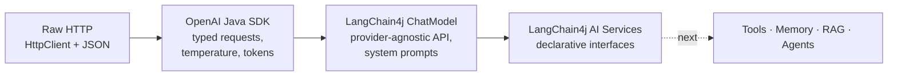

# LLM & Agentic AI in Java: OpenAI SDK + LangChain4j

Hands-on examples that build up, step by step, how to integrate **Large Language Models into Java applications**. The project starts from a raw HTTP call and goes on to the official **OpenAI Java SDK** and then to **LangChain4j AI Services**, which are the foundation for agentic AI in Java.


---

## What this project covers

| # | Example | Concept |
|---|---------|---------|
| 1 | [`LaunchAiAPP`](src/main/java/main/LaunchAiAPP.java) | Call the OpenAI **Responses API** with plain `java.net.http.HttpClient`: request body, Bearer auth, raw JSON response. Shows what the SDKs hide. |
| 2 | [`LaunchOpenSDK`](src/main/java/main/openaisdk/LaunchOpenSDK.java) | **OpenAI Java SDK** chat completions with a system prompt. Shows that LLM calls are **stateless**: the model only "remembers" earlier turns when you send the conversation history again. |
| 3 | [`LaunchOpenSDK2`](src/main/java/main/openaisdk/LaunchOpenSDK2.java) | **Temperature**: the same prompt at `0.0` (consistent output) vs `0.8` (varied output), with `maxCompletionTokens` to limit cost |
| 4 | [`LaunchOpenSDK3Token`](src/main/java/main/openaisdk/LaunchOpenSDK3Token.java) | **Token usage and cost awareness**: reading prompt, completion and total tokens from the response |
| 5 | [`LangChain4J`](src/main/java/main/langchain4j/LangChain4J.java) | **LangChain4j `ChatModel`**: simple `chat(String)`, `SystemMessage` + `UserMessage` guardrails that restrict answers to one domain, and token usage metadata |
| 6 | [`DemoSupportInterface`](src/main/java/main/langchain4j/DemoSupportInterface.java) | **LangChain4j AI Services**: a plain Java interface with `@SystemMessage`, `@UserMessage` and `{{template}}` variables. LangChain4j generates the implementation at runtime. |

---

## From raw HTTP to AI Services



Each step removes boilerplate and adds structure. AI Services are the building block LangChain4j uses for **tools (function calling), chat memory, RAG and agents**.

### AI Services in a few lines

```java
public interface DemoSupportInterface {
    @SystemMessage("""
        You are an experienced Java instructor.
        Explain concept in simple words.
        Always provide a small example.
        """)
    @UserMessage("Explain {{topic}} with a simple example! only defination short")
    String explain(@V("topic") String topic);
}

ChatModel model = OpenAiChatModel.builder()
        .apiKey(System.getenv("OPENAI_API_KEY"))
        .modelName("gpt-4o-mini")
        .build();

DemoSupportInterface support = AiServices.create(DemoSupportInterface.class, model);
System.out.println(support.explain("Java Dependency Injection"));
```

---

## Key takeaways

- **LLMs are stateless.** Conversation "memory" means sending the history again with each request, which is why chat-memory components exist.
- **System prompts are guardrails.** They keep the model to one domain and politely decline anything else.
- **Temperature controls creativity.** Use low values for deterministic answers and higher values for variety.
- **Tokens are cost.** Track input and output tokens and limit the response length.
- **Abstractions pay off.** LangChain4j's `ChatModel` lets you switch providers, and AI Services turn prompts into type-safe Java methods.

---

## Getting started

### Prerequisites
- JDK 21
- An OpenAI API key

### Configure the API key

The key is **never** stored in code. Every example reads it from the `OPENAI_API_KEY` environment variable:

```bash
# Linux / macOS
export OPENAI_API_KEY=sk-...

# Windows (PowerShell)
$env:OPENAI_API_KEY="sk-..."
```

In IntelliJ, set it under **Run Configuration → Environment variables**.

### Run

Each class has its own `main` method. Run it from your IDE, or from the command line:

```bash
./mvnw compile exec:java -Dexec.mainClass=main.langchain4j.LangChain4J
# Windows: mvnw.cmd compile exec:java -Dexec.mainClass=main.langchain4j.LangChain4J
```

---

## Tech stack

| | |
|---|---|
| Language | Java 21 (text blocks) |
| LLM frameworks | LangChain4j (`langchain4j`, `langchain4j-open-ai`) |
| Provider SDK | OpenAI Java SDK (`openai-java`) |
| Build | Maven (wrapper included) |

---

## Roadmap

- [ ] **Tools / function calling** with `@Tool` methods
- [ ] **Chat memory** (`MessageWindowChatMemory`) for real multi-turn conversations
- [ ] **RAG**: document loading, embeddings and a vector store (pgvector)
- [ ] **Agentic workflows**: multi-step agents that plan and call tools
- [ ] **Spring AI** versions of the same examples
- [ ] **MCP** (Model Context Protocol) client and server

---

## Author

**Alam** – Java full-stack developer (Java / Spring Boot, React) with 10+ years of experience, building with Spring AI, LangChain4j, RAG and agentic AI
GitHub: [@alamsoftware68](https://github.com/alamsoftware68) · Portfolio: [alaminfo.me](https://www.alaminfo.me)
